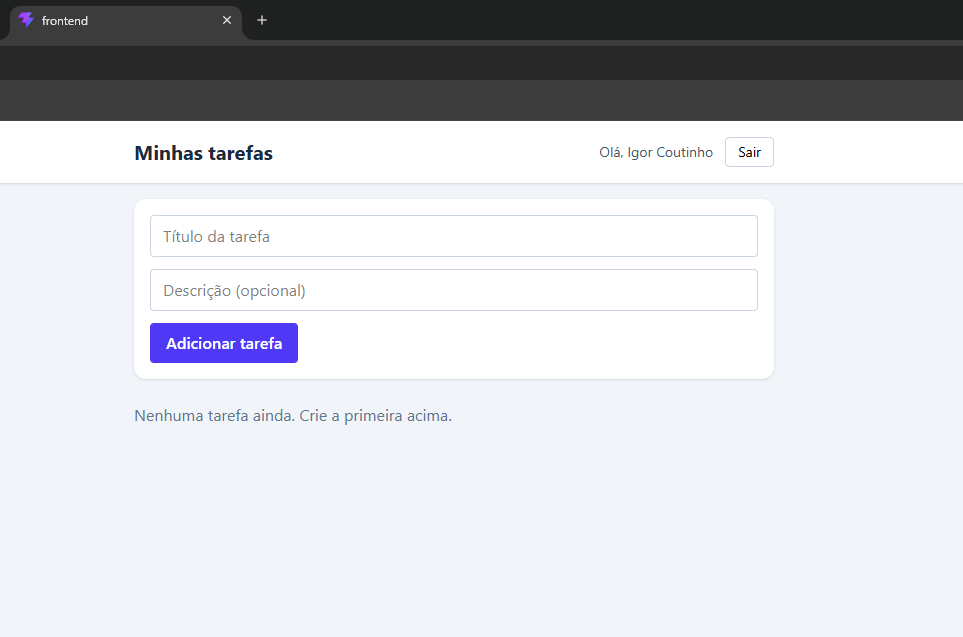

# Gerenciador de Tarefas

Aplicação fullstack para gerenciar tarefas pessoais. Cada pessoa cria uma conta, faz login e vê **apenas as próprias tarefas**.

🔗 **Demo:** https://gerenciador-tarefas-ten-iota.vercel.app

> ⏳ **Aviso:** o back-end roda em um plano gratuito que "dorme" quando fica sem uso. No primeiro acesso, o cadastro ou o login podem levar até 1 minuto. Se der erro, espere um pouco e tente de novo.



## O que o projeto faz

- Cadastro e login de usuários
- Criação, listagem, mudança de status (A fazer, Fazendo, Feito) e exclusão de tarefas
- Cada usuário acessa só as próprias tarefas
- Sessão que continua ao recarregar a página
- Rotas protegidas no front-end e no back-end

## Tecnologias

| Camada | Tecnologias |
|---|---|
| Front-end | React, TypeScript, Vite, Tailwind CSS, React Router |
| Back-end | Node.js, Express, TypeScript |
| Banco de dados | PostgreSQL (Neon), Prisma ORM |
| Autenticação | JWT e bcrypt (senhas com hash) |
| Deploy | Vercel (front-end) e Render (back-end) |

## Decisões técnicas

- **Senhas com hash (bcrypt):** o banco nunca guarda a senha original.
- **Autenticação com JWT:** o token vai no cabeçalho `Authorization: Bearer`, e um middleware valida em cada rota de tarefas.
- **Autorização por usuário:** toda consulta de tarefas filtra pelo `userId` do token. Tentar acessar a tarefa de outra pessoa retorna `404`.
- **Mensagem de login genérica:** e-mail inexistente e senha errada retornam o mesmo erro, para não revelar quais e-mails estão cadastrados.
- **CORS restrito:** em produção, o back-end só aceita requisições do endereço do front-end.

## Endpoints da API

| Método | Rota | Descrição | Autenticação |
|---|---|---|---|
| POST | `/auth/register` | Cria uma conta | Não |
| POST | `/auth/login` | Retorna o token | Não |
| GET | `/tasks` | Lista as tarefas do usuário | Sim |
| POST | `/tasks` | Cria uma tarefa | Sim |
| PUT | `/tasks/:id` | Edita uma tarefa | Sim |
| DELETE | `/tasks/:id` | Exclui uma tarefa | Sim |

## Como rodar localmente

Pré-requisitos: Node.js (LTS) e um banco PostgreSQL (por exemplo, um projeto gratuito no [Neon](https://neon.tech)).

```bash
git clone https://github.com/Igor-Couto10/gerenciador-tarefas.git
cd gerenciador-tarefas
```

**Back-end**

```bash
cd backend
npm install
```

Crie o arquivo `backend/.env`:

```
PORT=3333
DATABASE_URL="sua-string-de-conexao-postgresql"
JWT_SECRET="uma-chave-secreta-longa"
```

```bash
npx prisma migrate dev
npm run dev
```

**Front-end** (em outro terminal)

```bash
cd frontend
npm install
```

Crie o arquivo `frontend/.env`:

```
VITE_API_URL=http://localhost:3333
```

```bash
npm run dev
```

O app abre em `http://localhost:5173`.

## Próximos passos

- Testes automatizados
- Mensagens de erro mais detalhadas na API
- Edição do título e da descrição das tarefas

## Autor

**Igor Coutinho** — estudante de Engenharia de Software

[GitHub](https://github.com/Igor-Couto10) · [LinkedIn](https://www.linkedin.com/in/igor-coutinho-5998b7403)